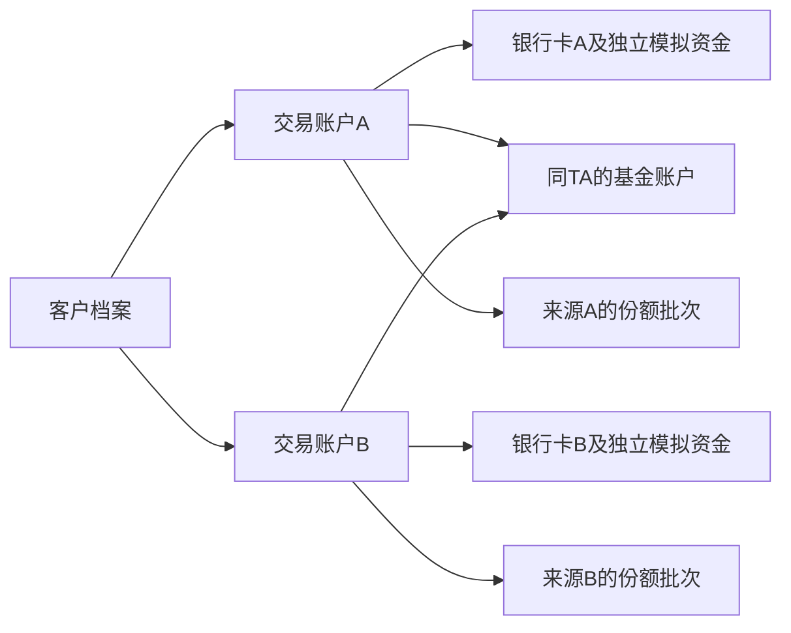

# 基金销售与模拟交易平台设计草案

本设计已形成可本地运行的实现，状态与必要调整见[验收记录](../../acceptance.md)。此文保留业务设计背景。

本文作为第一版实现计划的业务依据。目标是交付能在线持续使用的模拟基金平台，覆盖投资者操作、后台登记确认和日常运营，而不只制作展示页面。用户已确认上线目标为模拟交易；当前项目只有业务 PDF，没有既有代码或 Git 仓库。

状态：2026年10月4日第二版，补充导师要求的多银行卡与多交易账户，尚未实施。技术栈为建议，课程尚未提供指定框架、团队人数或交付日期；业务参数为本项目模拟规则，不能当作所有真实基金的统一规则。

## 产品范围

投资者端与管理后台使用同一个网站、同一个后端和数据库。支持股票型、债券型、混合型的净值基金，以及采用独立收益模型的货币基金。基金 A/C 类份额按独立可交易产品维护，并归属同一个基金产品。

| 功能 | 投资者端 | 管理后台 | 完成条件 |
| --- | --- | --- | --- |
| 账户 | 注册登录、改密、模拟开户、风险问卷、多银行卡、多交易账户、基金账户查询 | 客户与账户关系、卡状态、受控换卡、审计的密码重置、操作员管理 | 区分客户、基金账户、交易账户和结算卡；模拟开户无需真实身份证或银行卡 |
| 产品 | 列表、搜索筛选、自选、详情、风险与费率、净值或收益曲线、公告 | 基金及份额类别、交易规则、费率档位、文件和公告维护 | 用户看到的规则与交易实际执行的规则一致 |
| 模拟资金 | 初始资金、按交易账户充值提现、逐卡余额和流水、客户汇总 | 按客户、交易账户和银行卡查询与对账 | 不跨卡借用余额；所有余额变化有来源 |
| 日常交易 | 选卡申购、按账户或汇总赎回、撤单、费用预估、订单明细 | 交易日历、开放限制、净值发布、批量确认、逐卡到账和异常处置 | 保存来源账户及卡，汇总赎回明确拆单和原路回款 |
| 资产 | 持仓、可用冻结份额、成本、市值、持仓及累计收益、历史记录 | 用户持仓与份额流水查询 | 收益包括赎回、现金分红和货币收益，不把充值当收益 |
| 认购 | 新基金认购、募集结果与退款记录 | 募集参数、成立、封闭建仓、开放、募集失败退款 | 成功形成份额；失败退款与募集利息只支付一次 |
| 定投 | 按周或月设置计划、修改下期参数、暂停恢复终止、执行记录 | 计划查询、按日执行、失败原因 | 一期最多一笔申购；失败不反复扣款 |
| 分红 | 分红方式设置、现金分红或再投资记录 | 权益登记、除息及支付日期、权益快照、执行结果 | 现金和份额分别入账，再投资形成新份额批次 |
| 货币基金 | 万份收益、七日年化展示、每日收益、自动再投资 | 每日收益数据、资格快照、结转任务 | 每个自然日的收益最多入账一次 |
| 转换 | 选择支持的目标产品、费用预估、转换进度 | 同管理人的支持转换关系、确认、失败恢复 | 转出和转入关联，不作为普通钱包提现再充值 |
| 生命周期 | 查看募集、封闭、暂停、终止状态与清盘回款 | 暂停申购或赎回、恢复、终止、清盘分配 | 限制新业务并明确处置已受理订单 |
| 运营 | 站内通知、公告、帮助、个人记录 CSV 导出 | 交易与资金统计、任务记录、异常列表、审计、CSV 导出 | 失败原因可定位，导出内容符合用户权限 |

本版不实现场内股票或 ETF/LOF 买卖、跨市场转托管、QDII 境外日历、基金经理投资组合管理、真实支付或真实 TA 接入。定期开放、巨额赎回的部分确认与延期办理、后端收费属于后续独立业务，不在本版验收范围。普通产品仍支持后台暂停交易和延后支付的显式操作，不能把这些状态等同于巨额赎回处理。

## 建议架构

采用模块化单体：一个 Vue 网站包含用户端和后台，一个 Spring Boot 应用负责所有业务，MySQL 持久化数据，应用内定时任务执行登记确认、到账、定投和收益结转。手动执行与定时执行调用同一业务函数；TA 为应用内模拟模块。

建议使用 Vue 3、TypeScript、Vite、Vue Router、Pinia、Element Plus 和 ECharts；后端 Java 21、Spring Boot 4.1.1、Spring Security、JdbcTemplate；MySQL 8.4、Flyway 迁移；JUnit、MySQL 集成测试、Vitest 和 Playwright 验证。后端依赖跟随 Spring Boot BOM，前端与镜像在初始化时锁定精确版本。若课程指定其他栈，修改计划中的框架与路径，不改变业务验收规则。

选择 JdbcTemplate 是为了直接表达查询、事务和账户锁定，避免额外 ORM 或通用规则引擎。使用数据库保存登录会话，Cookie 设置 HttpOnly，线上使用 Secure 与 SameSite，并保留 CSRF 防护。单域名提供网站与 `/api`，不把访问令牌存到浏览器 localStorage。

部署采用一台服务器上的 Docker Compose，包含 Nginx、应用和 MySQL。数据库不暴露公网端口，数据使用持久卷；备份复制到服务器之外。此架构不引入 Redis、消息队列、微服务、分库分表或 Kubernetes。

官方依据：[Vue 3 文档](https://vuejs.org/guide/introduction.html)、[Spring Boot 系统要求](https://docs.spring.io/spring-boot/system-requirements.html)、[Spring JDBC 文档](https://docs.spring.io/spring-framework/reference/data-access/jdbc/core.html)、[MySQL 8.4 文档](https://dev.mysql.com/doc/refman/8.4/en/)、[Docker Compose 文档](https://docs.docker.com/compose/)。这些来源支持技术兼容性和能力；选用这套技术是项目建议。

## 模拟业务规则

### 客户和多银行卡账户

采用一个客户档案关联多个销售交易账户，每个交易账户当前绑定一张模拟银行卡，并拥有一个独立模拟资金子账户。客户在同一TA下复用一个基金账户；交易账户与基金账户可以多对多关联，首次购买该TA产品时模拟开立或关联，不能每加一张卡就在同TA重复开基金账户。不同TA可以各有一个基金账户。基金持仓按交易账户和批次保留，客户总览可以汇总。

这是一套明确的项目模型，参考[申万菱信网上交易规则](https://www.swsmu.com/contents/2020/3/31-978c2f501e84428c86bf721ce46c32a8.html)的多交易账户与每账户一张卡的安排。不同机构的银行卡和渠道约束存在差别；本项目允许同银行多张不同的模拟卡，不照搬某家机构全部限制。只接受系统定义的模拟卡标识，不收集真实完整卡号或银行卡密码；模拟持卡人必须与客户档案一致，界面明确标注模拟核验。

客户开通资格后，首次有效绑卡建立首个交易账户并发放100000.00元；初始发放按客户去重。后来新增卡建立新的交易账户，初始余额0；重复开户、解绑重绑、换卡不再发放。模拟钱包是平台内交易账户的资金子账户，不是银行真实余额；页面显示逐卡资金和所有交易账户合计，不再建立另一份可花的总钱包。

客户档案保存default_trading_account_id，页面显示该账户当前绑定的默认卡。默认卡只预填新操作，提交时必须传明确的交易账户和卡绑定版本，保存来源卡快照；改默认卡不改变旧订单、定投计划、批次或收款目标。停用默认卡须同时选择另一可扣款账户或清空默认，不能自动改用另一卡扣款。扣款仅使用指定账户的可用资金，不能自动借用其他卡余额。模拟卡支持单笔及单日购入限额，日额度按服务端提交自然日计算，认购、申购、定投合并占用；撤单和失败释放原申请占用额度，历史已完成扣款保留占用。查询必须同时校验客户归属和账户状态。

卡生命周期为ACTIVE、DISABLED、UNBOUND、REPLACED，收款能力独立记录为RECEIVABLE或BLOCKED。用户只能在ACTIVE与DISABLED之间切换；UNBOUND和REPLACED由解绑或换卡操作产生，不能直接改回ACTIVE。ADMIN可设置模拟收款受阻或恢复并记录原因。DISABLED表示停用新扣款，不阻止存量赎回、退款、现金分红和清盘回款；BLOCKED则保留应付款并显示等待处置，不将订单改成已到账。无可扣款卡时默认卡为空，新购入受阻，但仍能查询和处理存量资产。

解绑必须同时满足：交易账户可用与冻结余额为0、总份额为0、无待确认/待支付交易、无未结分红或货币收益尾差、无未终止定投。暂停计划仍阻止解绑；已终止计划和历史订单保留不阻止解绑。校验与解绑持有同一账户锁，关闭交易账户并保留卡、账户、流水及历史关联，不删除共享的TA基金账户。解绑默认卡时必须指定另一张可扣款卡或在无可用卡时清空默认。卡标识全局唯一；同一客户重绑已解绑的模拟卡复用卡记录，可建立新交易账户，但同一卡只允许一个活跃绑定且不能重复获得初始资金。

支持有资产时受控换卡：用户申请新的同银行、同模拟持卡人且未绑定其他交易账户的卡，ADMIN核准理由和模拟核验记录。冻结该交易账户新扣款及定投执行，处理或撤销未完成扣款申请，再在事务内更新当前卡绑定；交易账户编号、钱包余额、批次成本与历史来源卡不变。换卡产生版本、原卡、新卡、申请人、批准人、理由和生效时间的记录。

旧卡无法收款时，不把“旧卡在途全部到账”设为换卡前置条件。换卡授权列明需要改付的待支付记录，逐笔追加原目标、新目标和授权ID的路由变更；金额和历史来源不变，成功付款不允许改付。未来的赎回、分红或清盘付款使用当前绑定卡时必须引用有效换卡授权链，并保存实际目标及绑定版本；不能通过改默认卡替代授权。额度统计按交易账户保持连续，换卡不重置本日限额。

### 多卡交易的来源和回款

认购、申购、定投均固定交易账户、扣款卡、基金账户与绑定版本；每个新批次保留这些来源。未扣款的撤单或申购失败只释放原账户冻结，不需要额外生成银行付款；已扣款的认购失败退款及利息通过付款记录回原结算路径。按[证监会销售办法第二十条](https://www.csrc.gov.cn/csrc/c106256/c1653806/content.shtml)，赎回、分红及未成功认申购款原则上回到购入时使用的结算账户；本项目将受控换卡作为有记录的模拟例外处置，不声称可任意跨卡支付。

单账户赎回仅使用该交易账户的批次。客户汇总赎回可以选择多组“交易账户、赎回份额”，每个账户内部按FIFO预留，再产生一个交易组和逐账户子订单；不得用总持仓覆盖来源。所有子单分别校验最低赎回及剩余份额，整组申请和冻结在一个事务中成功或失败；按账户ID排序锁定。确认和支付逐子单进行，交易组按子单结果展示完成、处理中、部分失败，不能把部分到账标为全部到账。

同一子单原则上回到该交易账户的来源结算卡；没有换卡授权时不能让用户选择任意另一张卡收款。多卡赎回的总额等于各子单金额之和，费率按各自批次计算；取消交易组只允许所有子单均可撤时整体取消，否则用户逐个取消仍可撤的子单。每个子单幂等重跑不影响已经成功的子单。

定投保存明确交易账户和扣款卡，修改默认卡不改变计划；普通换计划卡只影响未来期次并留痕，受控换卡更新未来执行使用的绑定版本且保留旧期次。分红方式仍按客户与基金类别共用，但权益按交易账户及历史来源卡分开；现金分红逐账户付款，来源明细保留原卡，红利再投资和货币收益新增批次继承原交易账户与来源路径。转换首版一次只选择一个来源交易账户，目标批次保持该账户及来源卡；清盘按客户、交易账户和类别分别核算付款。换卡后同账户存在不同历史来源卡时，付款保留各批次来源明细和必要授权链，实际目标只能是该账户合法结算卡，不能靠用户总持仓决定目标。

### 日期和产品规则

统一以 Asia/Shanghai 处理业务日期，以服务端时间记录提交时间。交易日历保存明确的开放日期；产品有申购、赎回开放开关及截止时间。示例净值产品采用15:00截止，严格早于截止时间的申请归入当日，否则归入下个开放日；确认日默认 T+1、赎回支付日默认 T+3，均从 T 按交易日计算。参数按产品保存，不宣称所有基金都采用这些数值。

模拟场景固定使用2026年10月12日至16日以及19日为开放日，并将17日、18日设为关闭。测试不依赖运行机器的当天日期。学习演示环境可以通过注入时钟推进日期，公开在线环境只使用真实时间，不提供全局改时间或全库重置按钮。

公开环境中，净值仅在所属开放日15:10以后发布；自然日货币收益在次日00:10以后结转。日常交易最早在计划确认日09:00确认，赎回最早在计划支付日09:30到账，定投最早在顺延后的执行日10:00生成订单。手动运行也校验日期和时间，不绕过这些条件。任务每5分钟扫描一次到期业务；缺日历记录时停止该类业务并提示管理员，不将未知日期自动当作开放日。

净值区分草稿与已发布。只能使用订单所属交易日的已发布净值；缺失时等待，不用最近一日净值代替。已影响成交的净值与费率版本不能被覆盖；后续版本不改变历史订单。错误数据以关联原记录的更正流水处理，不删除成交历史。

### 精度和资金记录

金额保存为 DECIMAL(20,2)，份额为 DECIMAL(24,4)，净值为 DECIMAL(20,6)，费率为 DECIMAL(12,8)，计算使用 BigDecimal。中间计算保留至少12位，最终金额取2位、份额取4位，使用 HALF_UP；舍入差额记录在确认结果中。这是模拟规则，真实 TA 精度不是本项目的默认承诺。接口以十进制字符串传递金融数值，前端只展示和预估，后端负责最终核算。

净值产品采用前端外扣法：净申购金额=申购金额/(1+费率)，费用=申购金额-净申购金额，确认份额=净申购金额/净值。固定金额收费单独计算。赎回按各持仓批次的份额、净值和持有期费率算费用后汇总；持有天数按确认日期到有效赎回交易日期之间的自然日差计算，先进先出使用批次，并保留实际消耗的批次明细。

首次有效绑卡时按客户发放100000.00元到首个交易账户，开户重试和增绑卡不能重复发放。充值提现是指定交易账户的模拟操作；必须生成资金流水。各账户独立区分可用与冻结；持仓按账户区分总份额与冻结份额，另展示未确认申购和待到账赎回的在途信息。在途是订单查询结果，不再计入余额；跨账户总览仅汇总，不提供绕过来源的自由转账。

申购受理时冻结资金，确认后消耗冻结并增加已确认份额；赎回受理时冻结批次份额，确认后扣减份额并形成待支付应收款，到账后增加可用资金。取消或确认失败释放原冻结。份额与资金流水不可修改或删除，修改账户余额必须通过有来源、原因和操作者的流水。

订单提交以用户和请求键去重；重复请求先返回原订单，相同键但显式账户/卡/金额等原请求内容不同返回冲突。默认卡变化不能重新解析重试请求。每个订单的确认、取消、支付等事件设置唯一约束。资金流水的唯一来源包括资金子账户、业务来源和事件类型；份额流水包括交易账户、类别、业务来源和事件类型，分红权益和货币快照包括交易账户；不能仅用客户或全局分红事件ID去重，否则会阻止同客户第二个账户入账。账户和批次通过数据库事务及行锁防止重复花钱和重复赎回；确认与撤单竞争只能有一个成功。单笔业务的状态、余额、份额、流水和通知写入在同一事务中完成。

### 订单和批次

净值产品订单使用 SUBMITTED、CONFIRMED、COMPLETED、CANCELLED、FAILED。申购确认并入份额后即 COMPLETED；赎回 CONFIRMED 表示等待资金到账，到账后 COMPLETED。SUBMITTED 包含净值缺失等等待原因；FAILED 仅表示确定不能成交，批处理意外失败不把业务直接标成失败。募集业务额外等待成立，不强套 T+1。

日常申购和赎回仅能在归属交易日截止前撤销；不支持撤销已确认订单。认购示例规则不允许用户撤单；定投计划终止只影响未来期次，已生成订单按普通申购规则处理。已经受理的申请按固定规则和归属日期处理，后续暂停主要限制新申请；终止前必须处理或按明确原因撤销全部未确认订单，并完成未支付金额。

逐笔确认及逐笔支付使用独立事务；一笔失败不能使整批已成功记录丢失。任务记录日期、类型、各项结果及错误，订单事件唯一约束是重复执行保护的最终依据。应用重启后扫描应处理但未完成的日期和订单，使用相同处理函数补跑。

### 认购和定投

认购仅对净值产品的募集期开放。受理时保存账户与来源卡、认购金额及规则，原子预留并消耗认购款，形成该交易账户的募集认购在途资产；不能按普通申购仅冻结到T+1。成立事件按募集结束日期核算模拟利息，再按初始净值确认份额并核销认购在途；模拟年利率为产品输入参数，默认0。失败将认购在途转为原金额加利息的退款应收款，通过来源路径支付，不收认购费；卡收款受阻时保持待退款，不能凭空恢复为已支付。利息按认购有效日期到募集结束日期的自然日差、365天基数计算，金额取2位；平台仅模拟投资者侧账务，不生成真实基金财产估值。

定投支持每周指定星期和每月1至28日；因此不需要处理29至31日不存在的问题。非开放日顺延至下个开放日，最多保留一期待执行记录；按计划与原计划执行日唯一定位期次。余额不足记当期失败并通知，不自动补扣；修改、暂停、恢复、终止仅影响未执行期次，不追溯补扣暂停期。

### 分红和货币收益

分红保存权益登记日、除息日、支付日、每份分红金额和每位用户的权益快照。本模拟规则在登记日完成既有订单确认后，取该日结束时已确认总份额作为权益；快照最早在次日00:00生成，存在应在登记日确认但未完成的订单时等待，不能按不完整数据提前快照。用户在登记日截止前选择分红方式。此口径明确展示在样本产品规则中，不冒充所有真实基金的权益安排。

除息日将分红权益与持仓估值一并展示，未支付红利计入分红在途，避免暂时显示资产少了一笔钱。净值由后台发布除息后的值，业务程序不二次扣减净值。现金分红在支付日增加钱包，红利再投资按配置的除息日净值形成新批次，不收申购费；快照、支付和再投资均不能重复执行。按权益比例减少原批次成本，允许调整后的成本为负；再投资新批次成本为再投资金额。分红生成权益后发生赎回时，相关成本调整与权益归属按原批次保留，不能转嫁到后续新买的批次。

货币产品采用份额净值1.000000的模拟模型，使用每日万份收益独立结转；七日年化只作为后台录入的展示指标，不用于计算真实收入。明确的模拟计息规则是申购确认后的下一自然日起取得收益，赎回确认后的下一自然日起停止收益；每天从日初合资格份额快照计算，包含周末，万份收益支持负值。收益折算为四位份额自动再投资，记录未结转的精度尾差，次日收益使用结转后的合资格份额。该口径不是特定真实货币基金的业务复制。

### 转换和清盘

转换限同管理人、同渠道、后台明确配置的净值产品组合，不支持货币基金转换。冻结转出批次，按归属交易日的双方净值计算；转出费用按持有期计算，补差费率=max(目标申购费率-来源申购费率,0)，补差费用按外扣法核算。两侧在一个数据库事务中确认，缺任一净值等待，不先扣转出而丢失转入。转换不产生钱包现金流，保留转出和转入的关联、费用和新批次。

终止状态禁止新交易并停止定投。所有既有待确认订单和待支付款项处理完毕，且货币收益及分红结转完毕后，才允许清盘。后台输入最终每份清算分配额，按确认的剩余份额核算逐账户回款、核销持仓并记录清盘事件；每个事件、交易账户及类别的分配最多执行一次。清盘形成的新付款若受阻仍计为清盘应收，不因持仓已核销而从资产消失。不计算真实基金底层资产出售和清算成本。

### 风险与统计

模拟风险等级1至5；问卷结果有效期365个自然日。产品风险超过用户等级、未开户或测评过期时拒绝新购入，包括转换转入和定投执行；赎回不因测评过期受阻。问卷结果、产品风险、费率和交易规则版本随订单留存。此规则为教学简化。[证监会销售规则](https://www.csrc.gov.cn/csrc/c106256/c1653806/content.shtml)要求风险匹配；协会2026年发布的[适当性细则公告](https://www.amac.org.cn/xwfb/xhyw/202606/t20260612_27826.html)也说明风险分级与系统改造要求。

每个交易账户资产总额=该资金子账户可用与冻结+该账户已确认持仓市值+募集认购在途+待支付退款、赎回及清盘款+除息已生效的待支付分红，客户总资产等于这些账户资产之和。日常申购确认与增加份额在同一事务内，不存在已消耗资金却未增加份额的中间状态；其金额冻结时只计资金余额，不再计在途。认购在途核销并形成份额或退款应收款时只能计其中一种。累计收益=当前资产总额+累计模拟提现-累计外部模拟入金；按账户及客户分别计算，入金包括初始发放和充值。换卡不产生外部入金、提现或收益。费用自然反映在资产变化中；不额外重复扣减。转换前后成本转移，新批次保留承接成本；现金分红与再投资在累计收益中不重复计算。现金分红权益在除息生效前不额外加到资产中，防止与未除息持仓市值重复计算。

## 数据与职责

| 数据组 | 主要表 | 约束与职责 |
| --- | --- | --- |
| 账户 | users、customer_profiles、trading_accounts、bank_cards、card_bindings、card_change_requests、registrars、fund_accounts、trading_fund_accounts、risk_assessments、session tables | 一客户多交易账户，每账户一当前结算卡；基金账户按客户与TA唯一；绑卡版本保留；模拟卡唯一且归属本人 |
| 产品 | funds、fund_classes、rule_versions、fee_tiers、nav_records、money_income_records、trading_calendar、announcements、favorites | 基金类别日期的净值唯一；已发布版本不可覆盖；自选唯一 |
| 钱包 | wallets、cash_entries、debit_quota_entries | 每交易账户一个资金子账户；来源去重包含子账户；额度释放追溯原申请；余额与流水对账 |
| 持仓 | position_lots、lot_reservations、share_entries | 批次固定交易账户、基金账户、来源卡和取得日成本；冻结来源唯一；份额变动有流水 |
| 交易 | order_groups、orders、order_events、order_lot_allocations、payouts、payout_route_changes、job_runs、job_items | 多卡赎回拆单；资金路径留存来源、目标、绑定版本与换卡授权；请求键与事件去重 |
| 扩展 | offering_events、sip_plans、sip_runs、dividend_events、dividend_entitlements、conversion_pairs、conversion_links、liquidation_events、liquidation_items、money_income_snapshots | 定投显式扣款账户；权益、收益、清盘明细以交易账户参与唯一约束 |
| 运营 | notifications、audit_events | 通知来源唯一；操作者、对象、操作前后和时间可查 |

不要求每一张表单独配置页面，不做动态权限设计器、任意流程编辑器或通用金融产品规则引擎。CSV用于净值和收益导入及用户记录导出；上传只接受明确格式，大小限制5MB，不允许上传执行文件。公告首版使用纯文本和已审核链接。

## 页面与验收

用户页面包括登录注册、模拟开户与测评、银行卡与账户管理、基金账户查询、基金市场、自选、基金详情、选卡交易与订单、资产总览及按卡持仓、各账户资金流水、认购列表、定投计划、分红记录、转换、换卡申请、站内消息、个人设置与帮助。后台包括首页统计、客户与多账户关系、卡状态及换卡处置、基金规则、费率、交易日历、净值及货币收益、交易与持仓、认购募集、定投、分红、转换关系、清盘、支付阻塞及改付记录、任务记录、对账异常、公告、操作员与审计。

桌面端完整可用，用户端适配手机浏览器；后台以桌面操作为主。每个业务页面都有加载、空列表、校验失败、处理中和处理结果状态，并解释实际成交净值或到账日期。金额字段单位明确，曲线注明数据日期和模拟来源，不使用真实收益承诺或交易用语制造误解。

最终验收必须包含正常交易、截止时间边界、节假日顺延、费率档位和舍入、多批次赎回、撤单与确认竞争、重复提交、任务中断补跑、募集成功失败、定投余额不足、分红快照、货币收益结转、转换两侧一致、清盘回款、越权、停用账户、备份恢复和升级后历史数据保留。新增必须验证多卡不重复发初始资金、来源账户隔离、默认卡变更不改历史、多卡赎回拆单、停扣款仍可收款、同客户多账户分红去重、有资产禁止解绑、解绑与下单竞争、旧卡收款受阻后的有授权换卡改付、多TA基金账户复用，以及客户合计等于逐账户合计。计划中的每个任务明确负责相应验证。

部署前提供环境变量模板、数据库迁移、关闭演示时钟的生产配置、HTTPS、登录限速、依赖扫描、健康检查、日志轮转、每天一次异机备份，以及一次从备份恢复的记录。上线范围是模拟平台；域名、服务器和通知渠道尚未提供，本轮不采购或发布。
